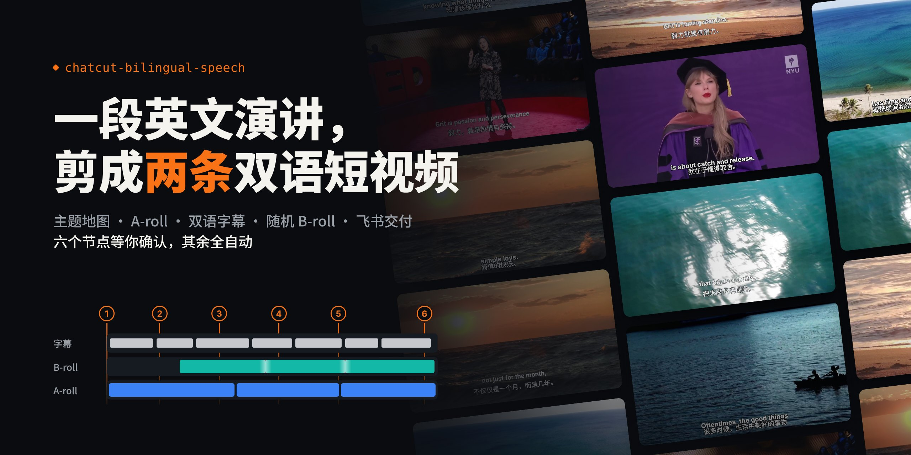
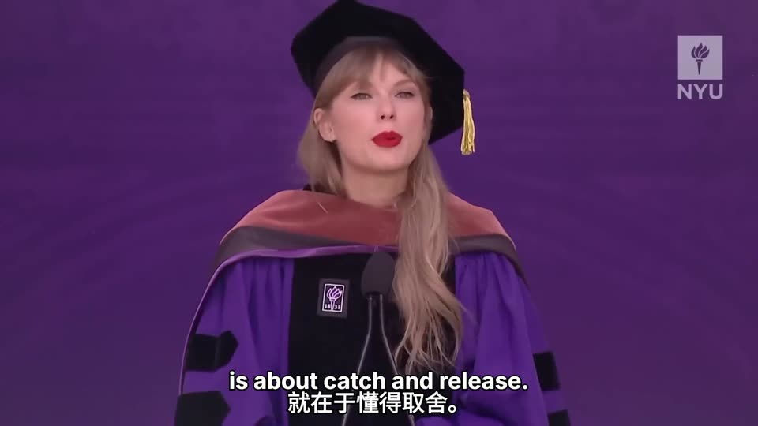
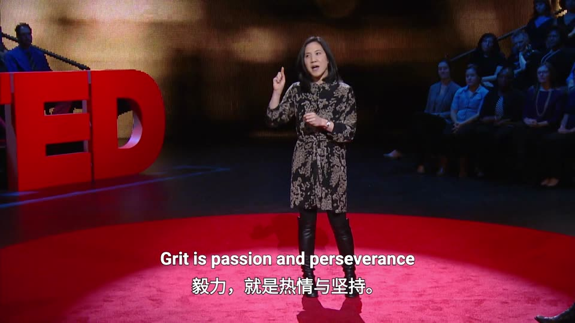

<a name="readme-top"></a>

<div align="center">
  

  <p><strong>一段英文演讲，剪成两条中英双语短视频</strong><br>
  <sub>可编辑时间轴，不出扁平成片 · 六个节点等你确认 · 交付核验后才算完成</sub></p>

  <p>
    <a href="#快速开始"><strong>快速开始</strong></a> &nbsp;·&nbsp;
    <a href="#能做什么">了解能力</a> &nbsp;·&nbsp;
    <a href="#成品案例">成品案例</a> &nbsp;·&nbsp;
    <a href="#六个确认节点">六个节点</a> &nbsp;·&nbsp;
    <a href="#配置">配置</a> &nbsp;·&nbsp;
    <a href="#常见问题">常见问题</a>
    <!-- TODO(英文版)：有 README_EN.md 后加上 &nbsp;·&nbsp; <a href="README_EN.md">English</a> -->
  </p>

  <p>
    <a href="https://github.com/issgy/chatcut-bilingual-speech/stargazers"></a>
    <a href="https://github.com/issgy/chatcut-bilingual-speech/commits/main"></a>
    
    
    
    <!-- TODO(许可证)：仓库加上 LICENSE 文件后取消注释
    <a href="LICENSE"></a>
    -->
  </p>
</div>

## 能做什么

- **从一段演讲里提两个主题**：读取带时间码的字幕或转写稿，提炼两个互不重复、单独成立的主题，每个片段都给出源时间段、英文原文、中文翻译和拼接风险。时间码不可靠就不进剪辑。
- **全程在 ChatCut 里剪**：A-roll、双语字幕、B-roll、导出都落在可编辑的 ChatCut 时间轴上，随时能打开改，不用本地渲染的扁平视频代替。
- **字幕排版有硬规则**：英上中下、白色粗体黑描边、每种语言最多一行；放不下就按语义和停顿拆成连续字幕，绝不缩字号、压字距或改写英文原话。
- **B-roll 随机但不重复**：只按 Google Drive 子文件夹名（如「雨夜城市街道」）挑分类，再随机无放回抽取，两条视频之间按文件 ID 去重，全部静音、叠化衔接，演讲原声一帧不动。
- **交付要核验才算数**：导出后上传飞书，回读文件确认可访问才汇报完成；全部成功后才把本次临时媒体移入废纸篓，从不永久删除。

## 成品案例

两条样片分别来自两段不同的演讲，都由本 Skill 按六个节点完整走完：主题地图 → A-roll → 双语字幕 → 随机 B-roll → 导出交付。点击封面观看成片。

<table>
  <tr>
    <td width="50%" align="center" valign="top">
      <strong>把生活留给值得的人和事</strong><br>
      <sub>泰勒·斯威夫特 · 2022 纽约大学毕业演讲 · 37 秒</sub><br><br>
      <!-- TODO(视频链接)：把下面的 href 换成 user-attachments 视频地址 -->
      <a href="assets/examples/taylor-swift-worth-it-cover.jpg"></a>
    </td>
    <td width="50%" align="center" valign="top">
      <strong>毅力，就是热情与坚持</strong><br>
      <sub>安吉拉·达克沃斯 · TED 演讲 · 26 秒</sub><br><br>
      <!-- TODO(视频链接)：把下面的 href 换成 user-attachments 视频地址 -->
      <a href="assets/examples/angela-duckworth-grit-cover.jpg"></a>
    </td>
  </tr>
</table>

- **A-roll**：开头是演讲原画面，抛出主题句；原声全程保留，没有背景音乐。
- **B-roll**：从用户确认的切入点开始，接入从素材库随机抽到的海浪、日落等风景素材，静音、叠化衔接。
- **字幕**：英上中下、白色粗体黑描边，每种语言一行，B-roll 段同样保持同步。

<div align="right"><a href="#readme-top">↑ 回到顶部</a></div>

## 快速开始

**1. 安装 Skill**

仓库根目录就是 Skill 本身，直接克隆进 Agent 的个人 Skills 目录即可。

Claude Code：

```bash
git clone https://github.com/issgy/chatcut-bilingual-speech.git ~/.claude/skills/chatcut-bilingual-speech
```

Codex：

```bash
git clone https://github.com/issgy/chatcut-bilingual-speech.git ~/.agents/skills/chatcut-bilingual-speech
```

WorkBuddy（克隆后重启 WorkBuddy；也可以在对话里直接把文件夹交给它导入）：

```bash
git clone https://github.com/issgy/chatcut-bilingual-speech.git ~/.workbuddy/skills/chatcut-bilingual-speech
```

<details>
<summary>Windows、其他 Agent，或者想升级？</summary>

<br>

**Windows PowerShell**（以 Claude Code 为例，其他 Agent 把 `.claude` 换成 `.agents` 或 `.workbuddy`）：

```powershell
New-Item -ItemType Directory -Force "$HOME\.claude\skills" | Out-Null
git clone https://github.com/issgy/chatcut-bilingual-speech.git "$HOME\.claude\skills\chatcut-bilingual-speech"
```

**其他 Agent**：本项目使用开放的 Agent Skills 目录格式。把整个文件夹放进目标 Agent 的 Skills 目录，保持 `SKILL.md`、`references/`、`config.example.json` 的相对位置不变；具体位置以该 Agent 的文档为准。也可以直接把仓库链接发给 Agent，让它帮你装。

**升级**：因为是直接克隆的，进目录拉一下就行，不会有旧文件残留。

```bash
git -C ~/.claude/skills/chatcut-bilingual-speech pull
```

</details>

**2. 准备好外部服务**

Skill 只包含流程规则，不附带账号、凭证或软件。你的 Agent 环境里需要能用 ChatCut、Google Drive 和飞书云盘（连接器、插件或已认证的 CLI 都可以），详见[依赖一览](#依赖一览)。

**3. 重开一个 Agent 任务，说一句话**

```text
用 chatcut-bilingual-speech 处理这个视频：<视频链接或本地路径>
```

第一次用时，Agent 会在第一个节点顺带问你 B-roll 素材库和飞书交付文件夹，直接在对话里回答就行，不用手动改配置文件。

<div align="right"><a href="#readme-top">↑ 回到顶部</a></div>

## 六个确认节点

正常流程只在这六处停下来等你；节点之间的步骤自动推进。遇到权限、登录或工具故障时如实报告，不绕过、不虚报成功。


<sub>橙色边框为确认节点，其余步骤自动执行。</sub>

| 节点 | Agent 做什么 | 需要你做的 |
|---|---|---|
| **① 源视频** | 核对你给的视频链接或本地文件，顺带收集缺失的素材库和交付位置 | 提供具体视频。只给演讲者、频道或主题不算，Agent 不会自己去搜 |
| **② 主题地图** | 提炼两个独立主题：源时间段、英文原文、中文翻译、片段作用、拼接顺序、断句和指代风险 | 确认地图。不确认不会进 ChatCut |
| **③ A-roll** | 在 ChatCut 建时间轴，按地图剪辑，保留原声、不加 BGM，默认 1920×1080 / 30fps | 在 ChatCut 里审片 |
| **④ 双语字幕** | 出样式样张并铺满全片字幕，按实际画幅测量每一条是否超行 | 一并确认样式与字幕时间轴 |
| **⑤ B-roll 切入点** | 问每条视频首次进入 B-roll 的时间；拿到答案后自动抽素材、下载、编排 | 每条给一个秒数、时间码或能唯一定位的台词 |
| **⑥ 最终成片** | 检查 B-roll、叠化、字幕与音频，给出素材使用摘要 | 确认后自动导出、交付、清理，不再额外问一次 |

> [!IMPORTANT]
> 你的确认只对当时展示的版本有效。之后改了什么，Agent 会回到受影响的节点重新确认，没变的内容不重复问。

<div align="right"><a href="#readme-top">↑ 回到顶部</a></div>

## 用一句话调用

| 场景 | 对 Agent 说 |
|---|---|
| 默认两条 | 用 chatcut-bilingual-speech 处理这个视频：`<链接>` |
| 指定主题和时长 | 用 chatcut-bilingual-speech 处理这个视频，一条讲失败的价值、一条讲专注，每条 60 秒左右：`<链接>` |
| 只要一条 | 用 chatcut-bilingual-speech 从这个演讲里剪一条双语短视频：`<链接>` |
| 自带字幕文件 | 用 chatcut-bilingual-speech 处理这个本地视频，配套英文字幕是同目录的 `talk.srt`：`<路径>` |
| 保留临时文件 | 用 chatcut-bilingual-speech 处理这个视频，交付后不要清理本地文件：`<链接>` |

> [!TIP]
> 在 Claude Code 里可以用 `/chatcut-bilingual-speech`，在 Codex 里用 `$chatcut-bilingual-speech`；WorkBuddy 等其他 Agent 直接描述需求即可。

最后你会得到：

- 每条保留视频的 **MP4 成片**（H.264、1920×1080、30fps），以及 ChatCut 中对应的**可编辑时间轴**；
- 上传到飞书交付文件夹的文件和**访问链接**，附上核验结果；
- 任务目录里留下的追溯材料：`topic-map.json`（主题地图）、`workflow-state.json`（节点确认、素材来源、交付凭据等）。

<div align="right"><a href="#readme-top">↑ 回到顶部</a></div>

## 配置

不配置也能用，Agent 会在第一个节点问你。想固定下来，把 `config.example.json` 复制到**任务工作区**（不是 Skill 安装目录），命名为 `chatcut-bilingual-speech.config.json`：

```json
{
  "broll_library": {
    "provider": "google_drive",
    "folder_url_or_id": "https://drive.google.com/drive/folders/<你的素材根目录>"
  },
  "delivery": {
    "provider": "feishu_drive",
    "folder_url_or_token": "https://<你的飞书域名>/drive/folder/<交付文件夹>"
  },
  "subtitle_style": {
    "english_font": null,
    "chinese_font": null,
    "english_size_1080p": 58,
    "chinese_size_1080p": 58,
    "black_outer_outline_px": 8,
    "max_width_ratio": 0.94
  },
  "cleanup": {
    "move_task_temporary_files_to_trash": true
  }
}
```

| 字段 | 说明 | 默认 |
|---|---|---|
| `broll_library.folder_url_or_id` | Google Drive 素材根目录的链接或 ID，子文件夹名即素材分类 | 未配置（不会全盘搜索） |
| `delivery.folder_url_or_token` | 飞书交付文件夹的链接或 token | 未配置（不会用任何默认文件夹） |
| `subtitle_style.*_font` | 中英文字体；留空时自动选当前可用的粗体 | `null` |
| `subtitle_style.*_size_1080p` | 1080p 下的字号（px），确认后不会为塞进一行而缩小 | `58` |
| `subtitle_style.black_outer_outline_px` | 黑色外描边宽度（px） | `8` |
| `subtitle_style.max_width_ratio` | 单行字幕最大宽度占画面宽度的比例 | `0.94` |
| `cleanup.move_task_temporary_files_to_trash` | 交付全部核验成功后，是否把本次临时媒体移入废纸篓 | `true` |

**优先级**：本次对话指令 > 你指定的配置文件 > 工作区 `chatcut-bilingual-speech.config.json` > 随包默认值。

> [!WARNING]
> 不要把口令、令牌、Cookie 写进配置文件。真实配置和 `workflow-state.json` 已在 `.gitignore` 中排除，分享仓库时不会被提交。

<details>
<summary><strong>B-roll 素材库怎么组织</strong></summary>

<br>

Agent 只看子文件夹名决定分类，所以文件夹名就是你给它的全部线索。建议按「场景 + 情绪」命名，每个分类放足够多的视频：

```text
B-roll 素材库/            ← folder_url_or_id 指向这里
├── 城市夜景/
├── 雨夜城市街道/
├── 城市雨夹雪/
├── 孤独/
├── 伤感/
└── 治愈/
```

每条成片至少用 3 个不同文件（B-roll 区间确实很短时可降到 2 个），两条之间不重复。按「2 条 × 3 个」估算，相关分类里至少要有 6 个可用视频；不够时 Agent 会先从其他合适的分类补，仍不够就报告缺口，不会静默重复使用。

</details>

<div align="right"><a href="#readme-top">↑ 回到顶部</a></div>

## 适合与不适合

| 适合 | 不适合 |
|---|---|
| 英文演讲、访谈、TED 式单人讲述，想切成中英双语短视频 | 多人快速对谈、需要标注说话人的内容 |
| 有带时间码的字幕，或环境里有转写能力 | 只有纯文本稿、对不上时间码（可以出候选主题，但不会进剪辑） |
| 想要演讲原声 + 风景 / 情绪类 B-roll 的固定风格 | 需要背景音乐、B-roll 原声或按画面内容精挑素材 |
| 你有权处理和发布这段视频 | 想让 Agent 帮你找视频、或者替你判断版权 |

<div align="right"><a href="#readme-top">↑ 回到顶部</a></div>

## 常见问题

<details>
<summary><strong>为什么要停六次？能不能全自动？</strong></summary>

<br>

剪辑里最贵的返工都来自前面的判断：选错主题，后面的字幕和 B-roll 全部白做。所以六个节点卡在「下游会依赖它」的地方，每次只确认一件事；节点之间的步骤都是自动的。

主题地图不能被自动选主题跳过，B-roll 切入点也不会根据节奏或旧项目推断（比如惯用的 7 秒 / 9 秒），必须由你明确给出。

</details>

<details>
<summary><strong>字幕太长放不下一行怎么办？</strong></summary>

<br>

Agent 会按最终画幅、字体、字号和安全区逐条测量。超行时按语义和原音停顿拆成连续的两条字幕，同一条中英文表达同一范围、同时出现；拆分时间依据逐词时间戳或听辨校准，不平均切。

不会做的事：改写英文原话、缩小已确认的字号、压缩字距、突破安全区。如果 ChatCut 当前不支持外描边等要求，会直接告诉你缺什么，不会悄悄换样式或改用本地烧录。

</details>

<details>
<summary><strong>为什么 B-roll 只按文件夹名随机，不看画面？</strong></summary>

<br>

这是刻意的：选材规则可预测，分类由你掌控，抽到什么就是什么，Agent 不会一边看缩略图一边按自己的审美重挑。只读取文件名、类型、时长这类技术信息。

最终合成核验仍会看画面，但只检查排版、黑帧、覆盖和转场，不借机重新筛选素材。只下载最终抽中的文件，不会预下载整个分类，也不会修改或删除 Drive 上的原始素材。

</details>

<details>
<summary><strong>我的视频没有字幕怎么办？</strong></summary>

<br>

优先用视频自带的字幕轨；没有时，如果 Agent 环境里有转写能力，会先转写再和原音核对。两者都没有时，Agent 会请你提供带时间码的 VTT / SRT。

只有纯文本也能出候选主题，但会标记「时间码待对齐」，在拿到可靠时间码之前不会进入剪辑。

</details>

<details>
<summary><strong>清理会删掉哪些文件？</strong></summary>

<br>

只在**全部上传并核验成功之后**，才把本次登记过绝对路径的临时文件移入系统废纸篓：下载的源视频、实际用到的 B-roll、ChatCut 导出缓存、浏览器下载副本等。

- 用系统可恢复的「移入废纸篓」，从不用 `rm` 永久删除；移不进去就保留并报告。
- 只匹配本次登记的路径，不按通配符清理下载目录或其他任务的文件。
- 不碰 ChatCut 云端项目、Google Drive 原始素材、你原有的源文件。
- 会保留主题地图、字幕数据、素材来源清单和飞书交付凭据，方便追溯。

部分上传失败时，所有仍需要的文件都会保留，并告诉你哪条成功、哪条待重试。设置 `cleanup.move_task_temporary_files_to_trash: false` 可完全关闭清理。

</details>

<details>
<summary><strong>中途想换主题、或者只要一条了，怎么办？</strong></summary>

<br>

直接说。改动会让下游确认失效，Agent 回到受影响的最早节点重新确认，没变的不重复问。

舍弃其中一条时，那条的后续工作全部停止；剩下那条的 B-roll 切入点会重新问你一次，即使之前已经给过。

</details>

<div align="right"><a href="#readme-top">↑ 回到顶部</a></div>

## 更多说明

### 依赖一览

这些能力可以来自连接器、插件或已认证的 CLI。缺少某项时，对应步骤会暂停并说明缺什么，不依赖它的步骤照常进行。

| 能力 | 用在哪里 | 缺少时 |
|---|---|---|
| ChatCut | ③ A-roll 到 ⑥ 最终成片、导出 | 主题地图仍能完成，剪辑暂停 |
| 字幕轨 / 转写能力 | ② 主题地图 | 请你提供带时间码的 VTT / SRT |
| Google Drive | ⑤ 列举分类、下载抽中的素材 | 停在素材抽取 |
| 飞书云盘 | ⑥ 之后的上传与回读核验 | 成片留在 ChatCut，不汇报交付完成 |
| 可读写的任务目录 | 全程：状态文件、临时媒体 | 无法开始 |
| 可恢复的「移入废纸篓」 | 交付后的清理 | 跳过清理，保留文件并报告 |

<details>
<summary><strong>目录结构</strong></summary>

<br>

```text
chatcut-bilingual-speech/
├── SKILL.md                  # 主流程与六个确认节点
├── config.example.json       # 示例配置（不含真实地址）
├── assets/                   # README 头图与成品案例封面（不影响 Skill 运行）
└── references/
    ├── setup.md              # 配置与接入说明
    ├── topic-map.md          # 主题地图规则与 topic-map.json 格式
    └── broll-delivery.md     # B-roll 选材、导出、飞书交付与清理规则
```

</details>

**深入文档**

- [配置与接入：所需能力、配置来源与优先级](references/setup.md)
- [主题地图：选题与剪辑逻辑、时间码规则、`topic-map.json` 格式](references/topic-map.md)
- [B-roll、导出、飞书交付与本地清理](references/broll-delivery.md)

## 使用须知

- 源视频必须由你提供。你主动给出视频并要求处理，即视为你声明拥有合法的处理依据；Skill 不会独立核验版权。公开发布前，请再确认一遍素材使用权。
- Skill 不会修改或删除 Google Drive 原始素材、ChatCut 云端项目或你原有的源文件。

## 反馈与贡献

欢迎在 [Issues](https://github.com/issgy/chatcut-bilingual-speech/issues) 提问题或建议。剪辑或字幕问题请附上对应节点的 ChatCut 截图，以及 `workflow-state.json` 中相关的部分（记得先去掉链接和 token）。

<!-- TODO(关于作者)：可选，填上后取消注释
## 关于作者

| 平台 | 账号 |
| --- | --- |
| 𝕏 Twitter | [@你的账号](https://x.com/你的账号) |
| 📕 小红书 | [你的昵称](你的主页链接) |
-->

<!-- TODO(许可证)：确定许可证后取消注释
## 开源许可

Skill 指令采用 [MIT License](LICENSE)。输入视频、B-roll 素材、生成的成片及其中出现的第三方内容，不因本许可证获得额外授权。
-->

<div align="right"><a href="#readme-top">↑ 回到顶部</a></div>
